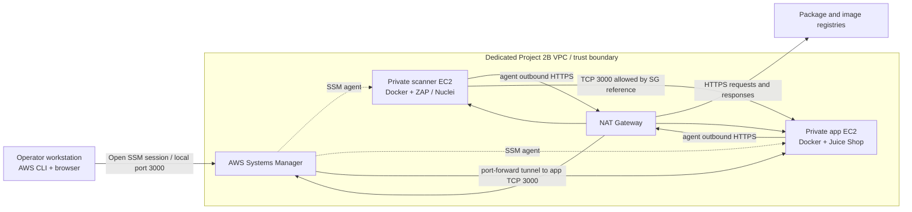

# Project 2B — Isolated Juice Shop Security Assessment

Deploy OWASP Juice Shop on private EC2 with Docker, then assess its IAM, network exposure, host controls, container, dependencies, code, and runtime behavior. This is an intentionally vulnerable training application. The lab has no public application endpoint and no WAF.

## Architecture



See [architecture notes](docs/architecture.md) and the Terraform source under [`terraform/`](terraform/).
The consolidated scan findings and IAM/network assessment are in [`docs/security-assessment.md`](docs/security-assessment.md).
The end-to-end sequence, troubleshooting, commands, and final cleanup are documented in [`docs/walkthrough.md`](docs/walkthrough.md).

## Repository layout

```text
modules/                 Reusable Terraform modules included in this repository
  iam/                   EC2 SSM roles and instance profiles
  network/               VPC, subnets, routes, NAT, and S3 endpoint
  storage/               Private temporary Ansible transfer bucket
terraform/               Project 2B root configuration and EC2-specific resources
  templates/             Cloud-init bootstrap scripts
ansible/                 Project-specific host-hardening playbooks (next stage)
docs/                    Architecture and assessment notes
scans/                   Sanitized scan evidence (do not commit secrets)
```

The network, IAM, and storage modules were copied and adapted from the author's Project 1B. They are vendored here so this repository can be cloned and used independently; Terraform does not need the Project 1B directory. See [`modules/README.md`](modules/README.md) for module roles and adaptation notes.

## Key controls and trade-offs

- Private subnets and no public IPs; no inbound SSH. Operators use Systems Manager and a local port-forward.
- Only the scanner security group can reach the app on TCP 3000.
- EC2 requires IMDSv2 and uses encrypted gp3 root volumes.
- Docker used the pinned Juice Shop image with dropped capabilities, no-new-privileges, PID and memory limits, and ephemeral app data. The successful manual run did **not** use a read-only root filesystem because Juice Shop writes files during startup; see the assessment for the discrepancy with the bootstrap template.
- The single-AZ NAT Gateway makes outbound package and image pulls simpler, but costs money while running. The reused network also creates a small S3 transfer bucket and endpoint even though the app lab does not need S3 transfers; this is an adaptation trade-off to revisit after the first learning run.
- Project 1B's hardening playbook is SFTP-specific; create a Project 2B playbook from its applicable baseline controls instead of running it unchanged.

## Tools and scan points

| Tool | Purpose | Where it runs |
| --- | --- | --- |
| Terraform | Reproducible VPC, EC2, IAM, and security-group configuration | Operator workstation |
| Docker | Isolated Juice Shop and scanner containers | App and scanner EC2 hosts |
| Ansible | Host baseline hardening and verification | Operator workstation over SSM |
| OWASP Dependency-Check | SCA of dependency manifests and image filesystem | Completed; report under `scans/` |
| SonarQube Community Build | SAST of source code | Completed; curated findings workbook under `scans/` |
| Trivy | Container image vulnerability scan | Planned; no retained completed result |
| Nuclei | DAST against the private running app | Completed; result under `scans/nuclei/` |
| OWASP ZAP | DAST against the private running app | Planned; no retained completed result |

## Requirements and deployment

Use a dedicated AWS learning account/profile with permission to manage the listed lab resources and start SSM sessions. AWS costs apply to EC2, NAT Gateway, EIP, storage, and data transfer. Set a budget alert and agree on a teardown window.

Follow [`terraform/README.md`](terraform/README.md). The deployment scaffold includes `terraform.tfvars.example`; copy it to a local `terraform.tfvars` and review the image tag, region, CIDRs, and instance types. Do not commit that local file, credentials, Terraform state, or scan data containing secrets.

No infrastructure is deployed by this repository preparation step. Review the Terraform plan before applying.

## Local option and cleanup

The security scanning tools can be learned locally with Docker and a Juice Shop container, but that does not exercise AWS IAM, security groups, SSM, or EC2 metadata controls. Use the AWS sandbox procedure for those objectives.

After the cloud assessment, run `terraform destroy` from the Terraform root and verify the instances, EIP, NAT Gateway, S3 bucket, and VPC are removed. Preserve only sanitized reports and screenshots.


