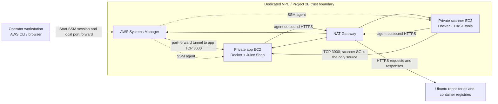

# Project 2B architecture

## Flows and trust boundaries

- **Management:** SSM agents initiate outbound HTTPS. No inbound SSH rule or public instance IP is configured. An operator's local browser reaches the app using SSM port forwarding.
- **DAST:** The scanner EC2 instance sends TCP 3000 traffic to the app. The app ingress rule references the scanner security group, not a broad CIDR.
- **Internet egress:** Instances use HTTPS egress through the NAT Gateway to obtain OS packages, container images, and SSM connectivity. NAT is billable while provisioned.
- **Application boundary:** Juice Shop is intentionally vulnerable. It has no public load balancer, WAF, or route from other projects. Keep real data and production credentials out of the lab.
- **Scan points:** SCA and SAST target a source checkout; Trivy scans the pinned container image; ZAP/Nuclei target the running private app.

This is a single-AZ learning architecture, not a highly available production design.

